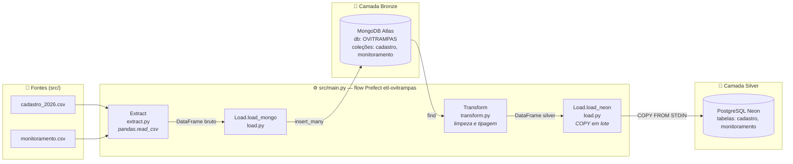

# ETL Ovitrampas — Recife

Pipeline ETL em Python que leva os dados de **ovitrampas** (armadilhas de monitoramento de ovos do *Aedes aegypti*) de arquivos CSV para dois bancos na nuvem, seguindo a ideia de camadas **Bronze → Silver**:

- **Bronze** — dados brutos, exatamente como vieram do CSV, salvos no **MongoDB** (banco `OVITRAMPAS`).
- **Silver** — dados limpos e tipados, salvos no **PostgreSQL (Neon)**, prontos para consulta e análise.

## Arquitetura



Versão em texto (para onde o Mermaid não renderiza):

```
 CSV (src/)                       MongoDB (Bronze)                     Neon/Postgres (Silver)
┌──────────────────┐            ┌──────────────────┐                 ┌──────────────────┐
│ cadastro_2026.csv│──Extract──▶│  OVITRAMPAS      │──Transform────▶ │ tabela cadastro  │
│ monitoramento.csv│  (pandas)  │  ├ cadastro      │  (limpa/tipa)   │ tabela           │
└──────────────────┘     │      │  └ monitoramento │        │        │   monitoramento  │
                         │      └──────────────────┘        │        └──────────────────┘
                         └── load_mongo ───────▲            └── load_neon (COPY) ──▲
```

### Fluxo (para cada tabela)

1. **Extract** — [src/extract.py](src/extract.py) lê o CSV da pasta `src/` com `pandas` (`utf-8-sig`, para lidar com o BOM).
2. **Load Bronze** — [src/load.py](src/load.py) `load_mongo` troca `NaN` por `None`, apaga a coleção antiga (`delete_many`) e insere tudo de novo (`insert_many`). A carga é **full refresh**: rodar de novo não duplica dados.
3. **Transform** — [src/transform.py](src/transform.py) lê a coleção bronze do Mongo e:
   - padroniza textos (`strip`) e coloca `bairro`, `id_ovt` e `bairro_area` em MAIÚSCULAS;
   - converte inteiros (`Int64`, que aceita nulo), coordenadas (`float`) e datas (`AAAA-MM-DD`); valores inválidos viram nulo em vez de quebrar o pipeline;
   - remove linhas duplicadas.
4. **Load Silver** — `load_neon` recria a tabela no Postgres (`to_sql` só com o cabeçalho, `if_exists="replace"`) e manda os dados com `COPY ... FROM STDIN`, bem mais rápido que um `INSERT` por linha.

## Orquestração (Prefect)

O pipeline é orquestrado com o [Prefect](https://www.prefect.io/):

- [src/main.py](src/main.py) define o **flow** `etl-ovitrampas` (`@flow(log_prints=True)`), que percorre as tabelas e chama cada etapa.
- Cada etapa é uma **task** do Prefect (`@task(cache_policy=NO_CACHE)`): `Extract.extract_csv`, `Load.load_mongo`, `Transform.transform_to_silver` e `Load.load_neon`. O `NO_CACHE` faz toda execução processar os dados de novo, sem reaproveitar resultados anteriores.
- Os `print` das etapas aparecem nos logs do Prefect, junto com o estado de cada task.
- **Agendamento diário:** com `--agendar`, o script fica rodando e executa o flow todo dia às **06:00** (constante `HORA_EXECUCAO`). Se uma execução falhar, o erro é registrado e o agendamento continua. O agendamento é feito em Python porque o `.serve(cron=...)` não agenda nada no servidor temporário do Prefect.
- No Windows, o `main.py` silencia um `ConnectionResetError [WinError 10054]` inofensivo do asyncio, que aparecia quando o servidor temporário do Prefect era encerrado.

## Dados

| Tabela | Arquivo | Linhas (aprox.) | Conteúdo |
|---|---|---|---|
| `cadastro` | `cadastro_2026.csv` | ~2,9 mil | Cadastro e georreferenciamento de cada ovitrampa (id, bairro, distrito, endereço, latitude/longitude, agente, data de cadastro) |
| `monitoramento` | `monitoramento.csv` | ~163 mil | Leituras por ciclo: ovitrampa, ciclo, datas de campo/laboratório/digitação, técnico e **número de ovos** |

As duas tabelas se ligam pela coluna `id_ovt` (ex.: `REC 1001`).

> **Atenção:** em `cadastro` o id vem com espaço (`REC 1001`) e em `monitoramento` sem (`REC1001`). A transformação atual só faz `strip` e maiúsculas, então um *join* direto por `id_ovt` pode não casar — vale normalizar (ex.: remover espaços) antes de cruzar as tabelas.

## Estrutura do projeto

```
projeto_certo/
├── requeriments.txt     # dependências
└── src/
    ├── .env             # credenciais (NÃO versionar)
    ├── main.py          # orquestrador: flow Prefect + agendamento diário
    ├── extract.py       # classe Extract   → lê CSV
    ├── transform.py     # classe Transform → bronze (Mongo) → silver (DataFrame)
    ├── load.py          # classe Load      → grava no Mongo e no Neon
    ├── cadastro_2026.csv
    └── monitoramento.csv
```

## Como rodar

### 1. Ambiente e dependências

```bash
python -m venv .venv
# Windows
.venv\Scripts\activate
# Linux/macOS
source .venv/bin/activate

pip install -r requeriments.txt
```

Dependências: `pandas`, `pymongo`, `python-dotenv`, `sqlalchemy`, `certifi`, `psycopg[binary]`, `prefect`.

### 2. Variáveis de ambiente

Crie o arquivo `.env` com:

```env
MONGODB_uri=mongodb+srv://<usuario>:<senha>@<cluster>.mongodb.net/
DATABASE_URL=postgresql+psycopg://<usuario>:<senha>@<host>.neon.tech/<banco>?sslmode=require
```

- `MONGODB_uri` — string de conexão do MongoDB Atlas (camada bronze).
- `DATABASE_URL` — string de conexão do Neon. Use o prefixo `postgresql+psycopg://` para o SQLAlchemy usar o driver `psycopg` (v3), que é o que o `COPY` em `load.py` espera.

### 3. Executar

Na raiz do projeto, para rodar o ETL **uma vez**:

```bash
python src/main.py
# ou
python -m src.main
```

Para deixar rodando com **execução diária às 06:00** (Ctrl+C para parar):

```bash
python src/main.py --agendar
```

Saída esperada (além dos logs do Prefect):

```
--- ETL: cadastro ---
2874 registros inseridos na coleção 'cadastro'!
dados de 'cadastro' transformados em silver!
salvando 'cadastro' no Neon...
... registros salvos no Neon na tabela 'cadastro'!
--- ETL: monitoramento ---
...
ETL finalizado!
```

## Adicionando uma nova tabela

1. Coloque o CSV em `src/`.
2. Registre no dicionário `tabelas` em [src/main.py](src/main.py):
   ```python
   tabelas = {
       "cadastro": "cadastro_2026.csv",
       "monitoramento": "monitoramento.csv",
       "nova_tabela": "novo_arquivo.csv",
   }
   ```
3. Em `Transform.transform_to_silver`, adicione um bloco `elif tabela == "nova_tabela":` com as conversões específicas dela. As colunas comuns (`arquivo`, `aba`, `bairro`, `id_ovt`, `agente_matricula`, `linha`, `ano`, `distrito`, `qt`) são tratadas para todas as tabelas e precisam existir no CSV.

## Observações

- Cada execução **substitui** os dados nos dois bancos (Mongo: `delete_many`; Neon: `if_exists="replace"`).
- O `.env` contém credenciais: nunca faça commit dele.
